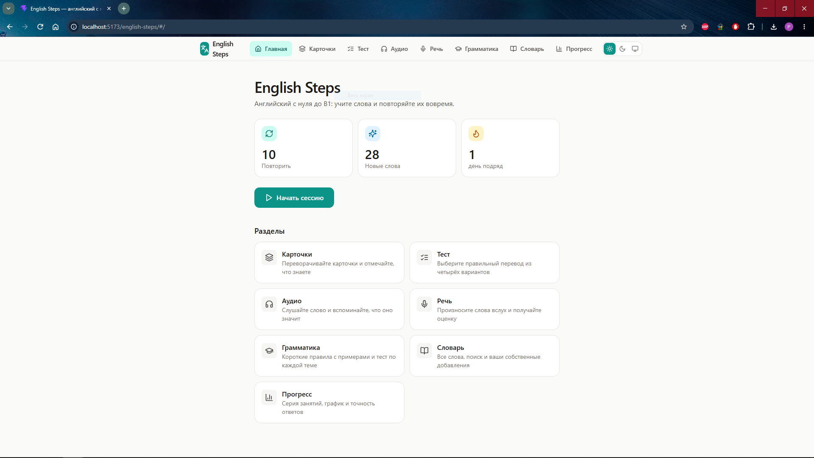
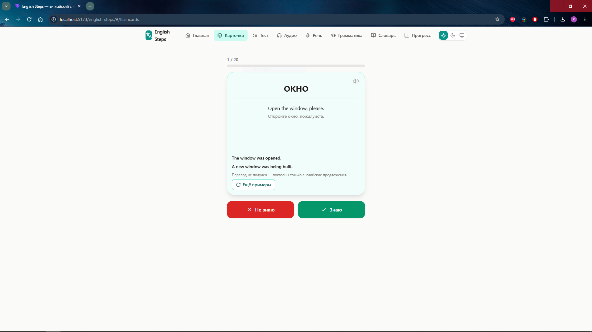
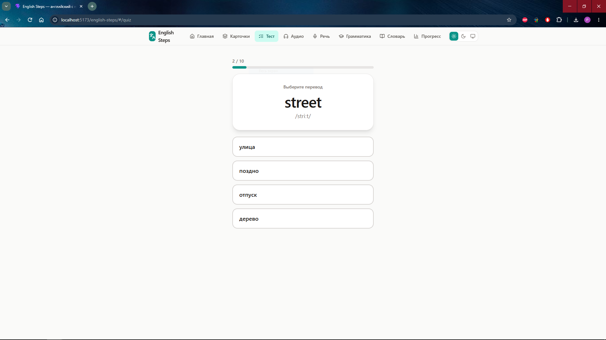
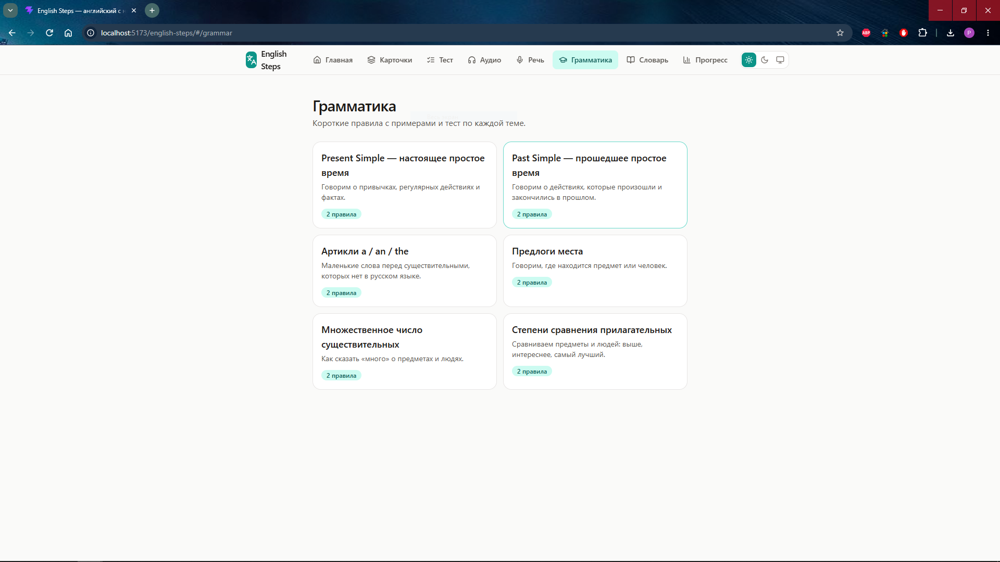
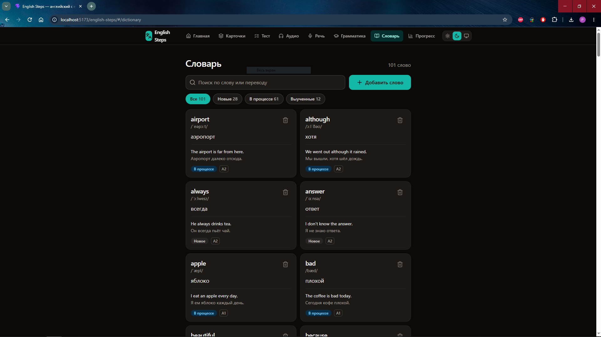
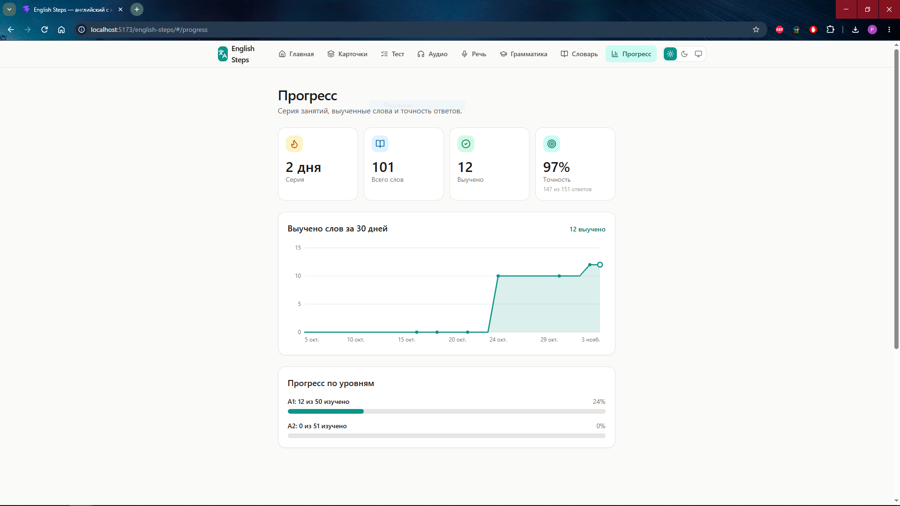

# English Steps 🎓

Веб-приложение для изучения английских слов с использованием алгоритма интервального повторения (FSRS) и локального искусственного интеллекта.


## 📖 О проекте

English Steps — это pet-проект, созданный для изучения английского языка с нуля до уровня B1. В отличие от простых карточек, здесь используется научный подход к запоминанию (FSRS), проверка произношения и локальная нейросеть для генерации примеров.

### Режимы обучения:
- **Карточки (Flashcards)** — переворот карточек. Теперь с **ИИ-примерами** (локальная нейросеть генерирует новые предложения со словом).
- **Тест** — выбор правильного перевода из 4 вариантов.
- **Аудирование** — прослушивание слова через Web Speech API.
- **Произношение** — микрофон слушает вас и фонетически сравнивает с правильным словом (прощая акценты).
- **Грамматика** — 6 тем с правилами и тестами (Present Simple, Past Simple, Артикли и др.).
- **Словарь** — управление словарём, поиск, фильтры, **Экспорт/Импорт** прогресса в JSON.
- **Прогресс** — SVG-график выученных слов, точность и прогресс по уровням.

## 🛠 Технологии

- **React 18** + **TypeScript** — UI и строгая типизация.
- **Vite** — сборка и dev-сервер.
- **Tailwind CSS** — стилизация (включая тёмную тему).
- **Zustand** — стейт-менеджмент с сохранением в `localStorage`.
- **React Router (HashRouter)** — навигация (готово к деплою на GitHub Pages).
- **Web Speech API** — распознавание и синтез речи.
- **WebLLM (@mlc-ai/web-llm)** — локальная нейросеть (Llama 3.2 1B) прямо в браузере через WebGPU. Работает офлайн, без API-ключей.
- **FSRS** — адаптивный алгоритм интервального повторения.

## 🧠 Архитектура и алгоритмы

- **Система FSRS:** Адаптивное повторение. У каждого слова есть `stability` и `difficulty`. Правильный ответ увеличивает интервал, ошибка — сбрасывает. Лёгкие слова повторяются реже, сложные — чаще.
- **Гибридный ИИ:** Генерация английских предложений и перевод разделены на два шага (чтобы маленькая модель не путалась). Результаты проходят строгую валидацию (отсев «каши» из двух алфавитов).
- **Фонетика:** Расстояние Левенштейна + своя фонетическая нормализация. Позволяет засчитывать «cat» при произношении «kat».
- **Безопасность:** Валидация данных в `localStorage` и при импорте JSON. Защита от XSS и нехватки места на диске.

## 🚀 Запуск проекта

```bash
# Клонируйте репозиторий
git clone https://github.com/smesnoi/english-steps.git
cd english-steps

# Установите зависимости
npm install

# Запустите dev-сервер
npm run dev

# Соберите production-версию
npm run build 
```

## 📸 Скриншоты


*Главная страница со статистикой*


*Режим карточек с ИИ-примерами*


*Тест на выбор перевода*


*Темы грамматики с правилами и тестами*


*Словарь с фильтрами*


*График прогресса*

## 📂 Структура проекта

```text
src/
├── components/       # UI-компоненты (сессии, словарь, прогресс, грамматика)
├── data/             # Стартовый набор слов и темы грамматики
├── hooks/            # Кастомные хуки (озвучка, микрофон, WebLLM)
├── pages/            # Страницы приложения (8 разделов)
├── store/            # Zustand-стор (слова, прогресс, тема)
├── types/            # TypeScript-типы
└── utils/            # Логика (FSRS, фонетика, графики, парсинг ИИ)
```

## 📄 Лицензия

Этот проект создан в учебных целях. Вы можете свободно использовать его код для своих pet-проектов.
