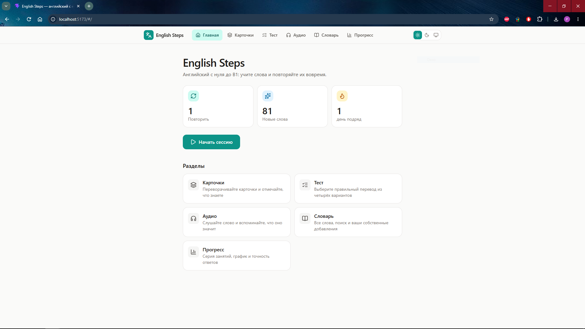
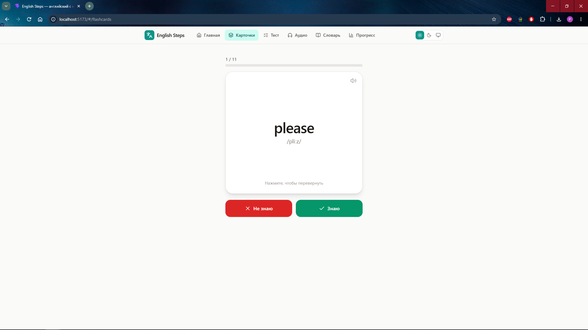
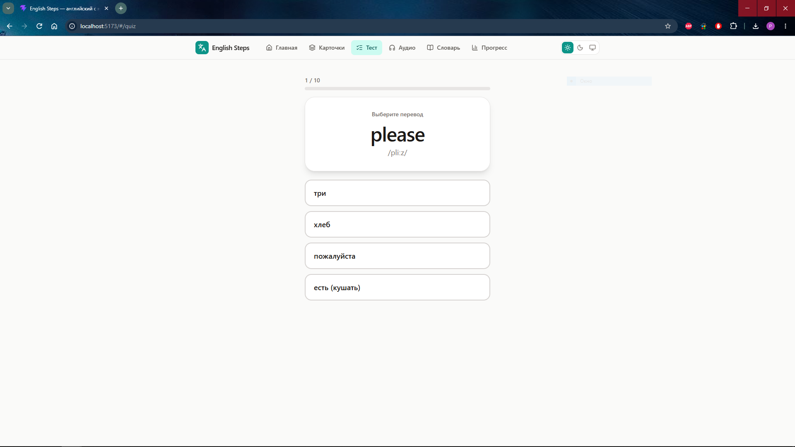
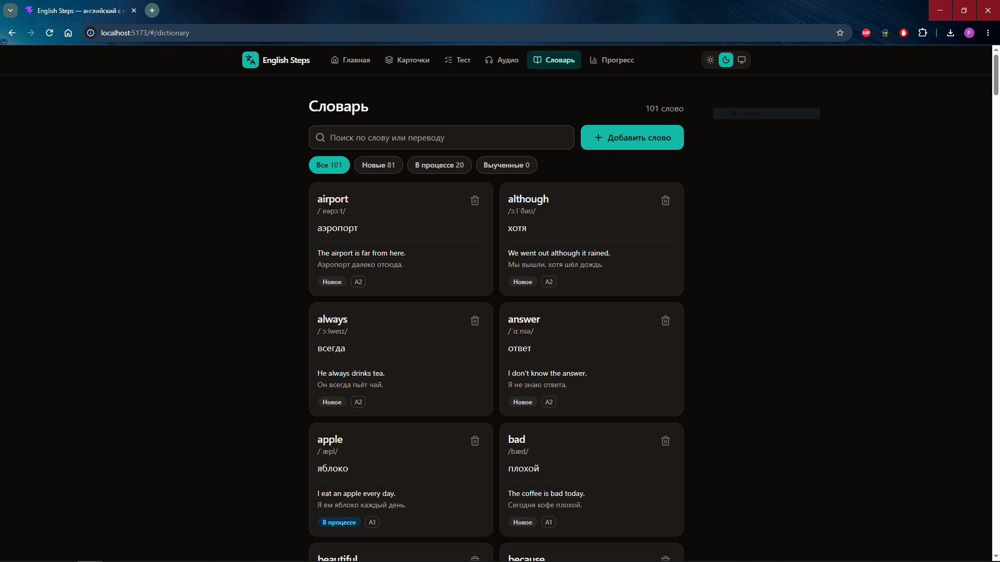
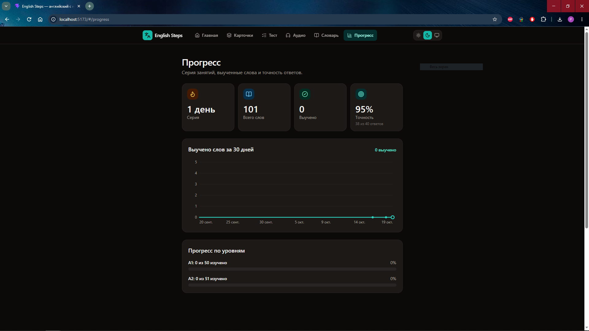

# English Steps 🎓

Веб-приложение для изучения английских слов с использованием алгоритма интервального повторения (система Лейтнера).

## 📖 О проекте

English Steps — это pet-проект, созданный для изучения английского языка с нуля до уровня B1. В отличие от простых карточек, здесь используется научный подход к запоминанию: слова возвращаются на повторение именно тогда, когда вы готовы их забыть.

### Режимы обучения:
- **Карточки (Flashcards)** — классический переворот карточек для узнавания слов.
- **Тест** — выбор правильного перевода из 4 вариантов.
- **Аудирование** — прослушивание слова через Web Speech API и выбор перевода.
- **Словарь** — управление своим словарём (поиск, фильтры по статусу, добавление и удаление слов).
- **Прогресс** — визуальная статистика (SVG-график выученных слов, точность, прогресс по уровням A1/A2/B1).

## 🛠 Технологии

- **React 18** + **TypeScript** — UI и строгая типизация.
- **Vite** — сборка и dev-сервер.
- **Tailwind CSS** — стилизация (включая тёмную тему).
- **Zustand** — стейт-менеджмент с сохранением в `localStorage`.
- **React Router (HashRouter)** — навигация (готово к деплою на GitHub Pages).
- **Lucide React** — иконки.
- **Web Speech API** — озвучка слов (встроено в браузер, без внешних библиотек).

## 🧠 Архитектура и алгоритмы

- **Система Лейтнера (SRS):** Слова разбиты на 6 коробок с интервалами повторения (1, 2, 4, 7, 14 и 30 дней). Правильный ответ переводит слово в следующую коробку, неправильный — сбрасывает в нулевую.
- **Безопасность данных:** Вся работа с `localStorage` обёрнута в `try/catch` и валидаторы. Если данные повреждены — приложение не упадёт, а подставит значения по умолчанию.
- **Чистые функции:** Логика SRS, расчёт стрика и генерация данных для графиков вынесены в `utils/`, что делает их легко тестируемыми (и покрытыми тестами).

## 🚀 Запуск проекта

\`\`\`bash
# Клонируйте репозиторий
git clone https://github.com/your-username/english-steps.git
cd english-steps

# Установите зависимости
npm install

# Запустите dev-сервер
npm run dev

# Соберите production-версию
npm run build
\`\`\`

## 📸 Скриншоты

*Главная страница со статистикой*

*Режим карточек*

*Тест на выбор перевода*

*Словарь с фильтрами*

*График прогресса*

## 📂 Структура проекта

\`\`\`text
src/
├── components/       # UI-компоненты (сессии, словарь, прогресс)
├── data/             # Стартовый набор слов (100 шт.)
├── hooks/            # Кастомные хуки (озвучка, анимация)
├── pages/            # Страницы приложения (6 разделов)
├── store/            # Zustand-стор (слова, прогресс, тема)
├── types/            # TypeScript-типы
└── utils/            # Логика (SRS, даты, графики, localStorage)
\`\`\`

## 📄 Лицензия

Этот проект создан в учебных целях. Вы можете свободно использовать его код для своих pet-проектов.